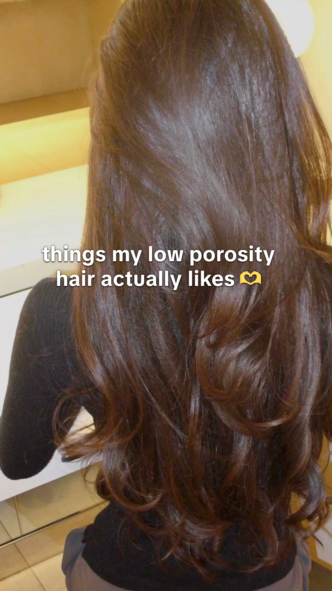
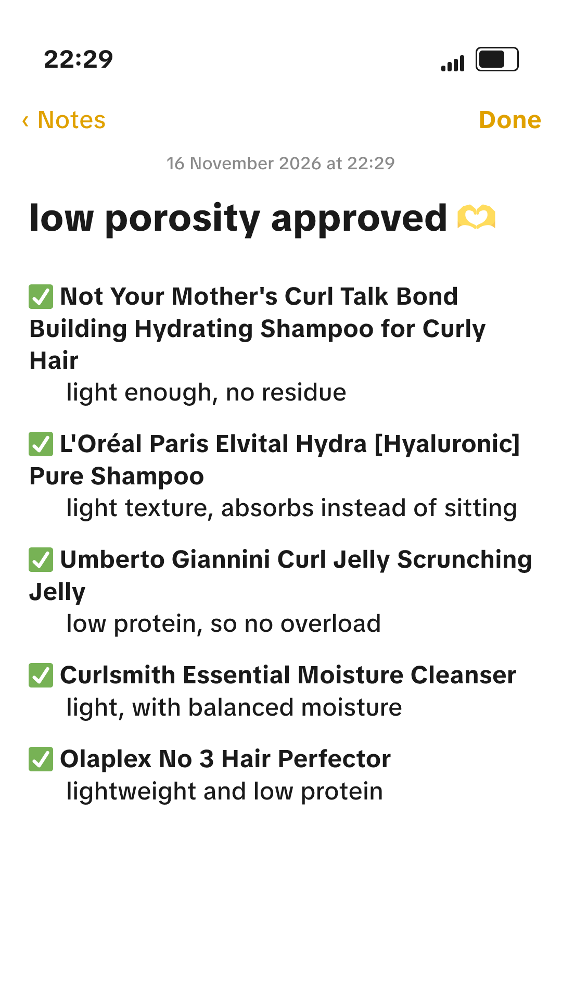
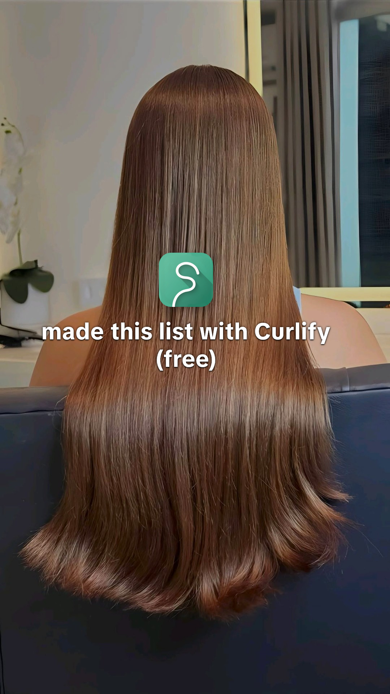

# best products for low porosity hair (tested in Curlify)

**Hook:** things my low porosity hair actually likes 🫶

**Description**

low porosity approved: Not Your Mother's Curl Talk shampoo, Elvital Hydra Pure, Umberto Giannini Curl Jelly, Curlsmith Essential Moisture Cleanser and Olaplex No 3. all light enough to absorb instead of sitting on top, checked in Curlify 🫶

#haircare #hairtok #hairroutine #lowporosityhair #hairproducts

**Pinned comment:** checked them all in Curlify, free on iOS + Android. it tells you if a product suits your hair type

