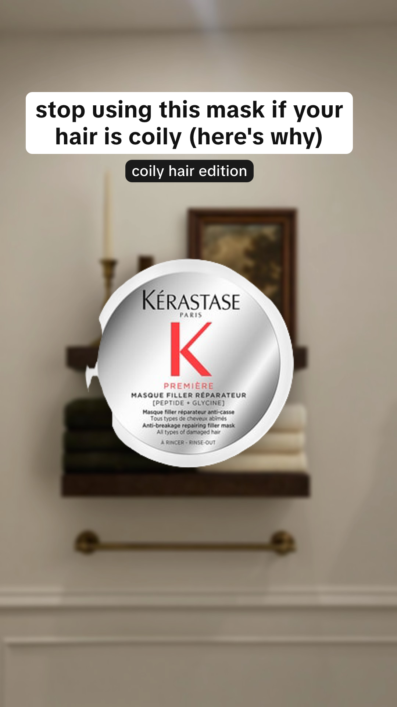
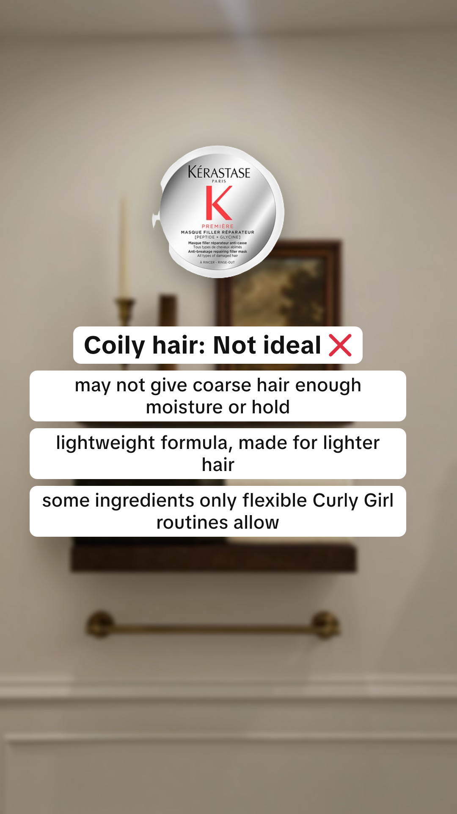
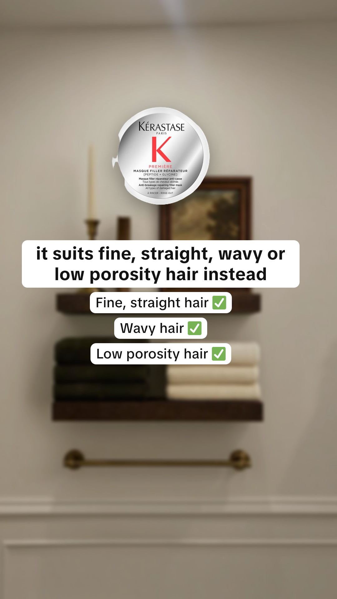
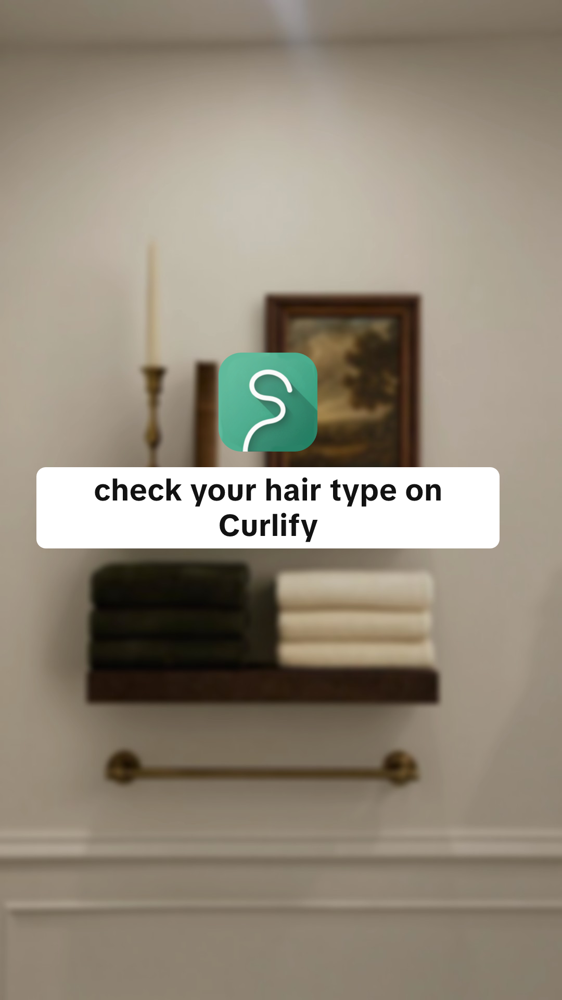

# Kérastase Première hair mask for coily hair? what Curlify says

**Hook:** stop using this mask if your hair is coily (here's why)

**Description**

Is the Kérastase Première Hair Mask for Damaged Hair good for coily hair? Curlify checked it: not ideal for coily, but a good match for fine, straight, wavy and low porosity hair.

#haircare #hairtok #hairroutine #coilyhair #productreview

**Pinned comment:** it's Curlify! you can scan any product and see how it fits your hair type

