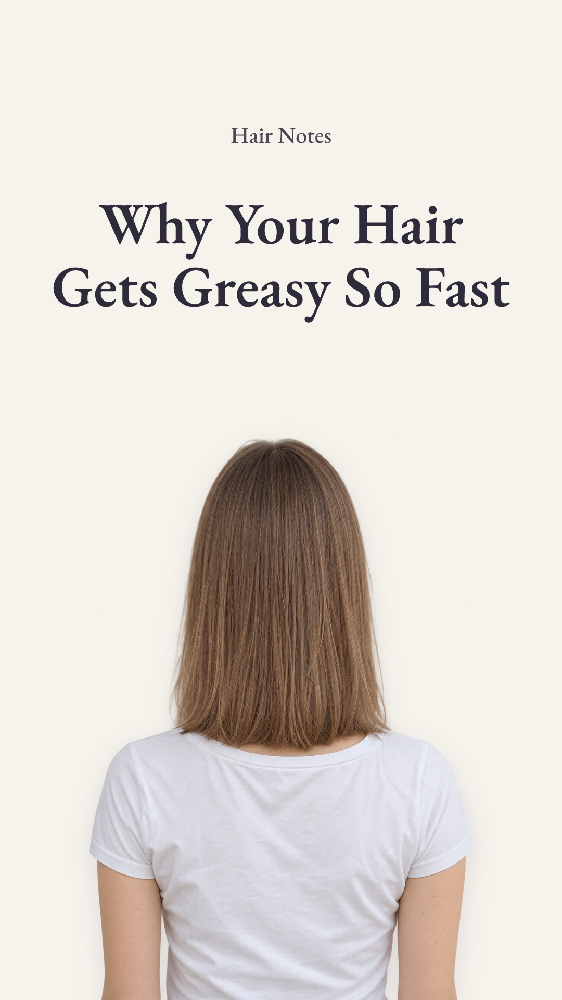
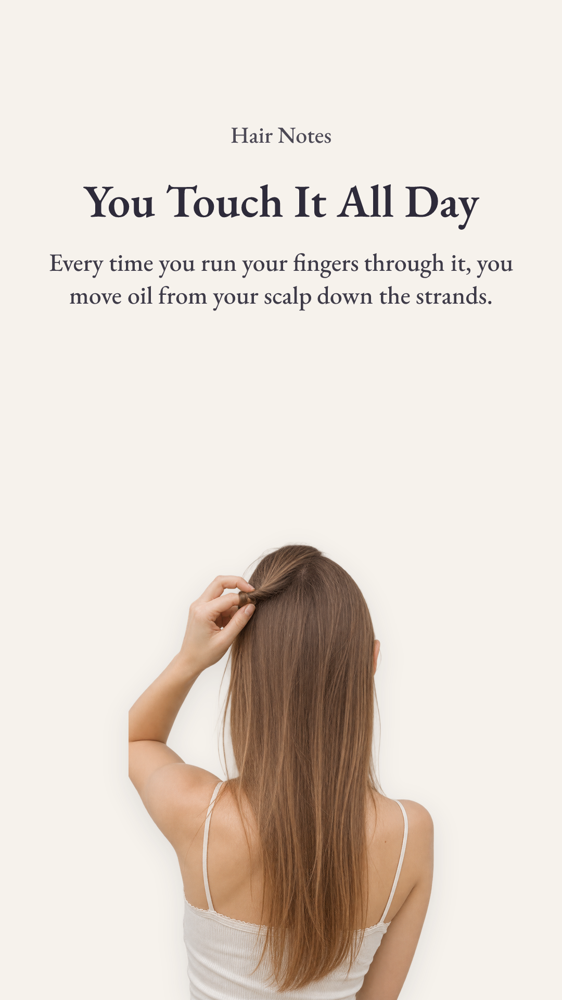
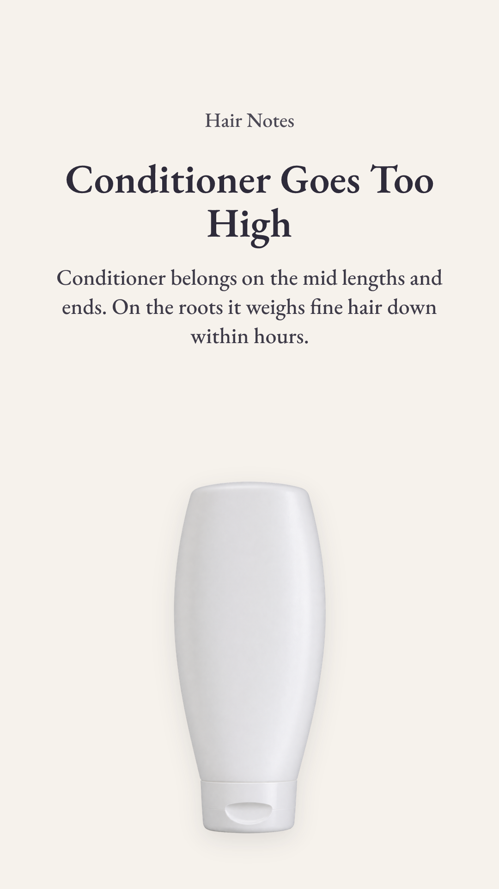
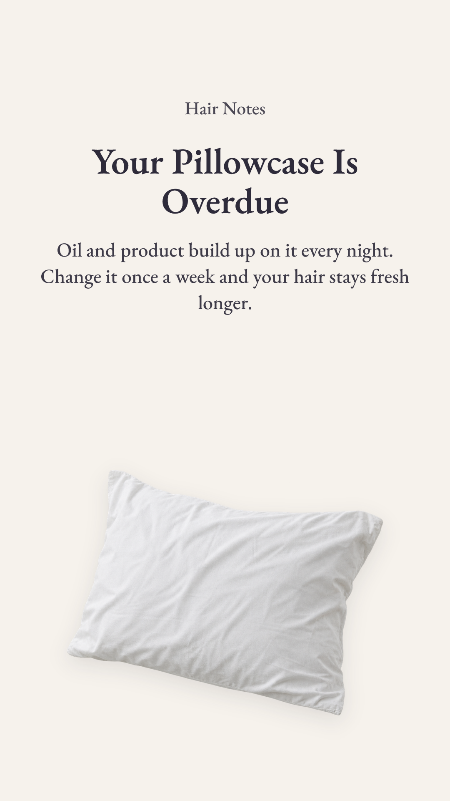
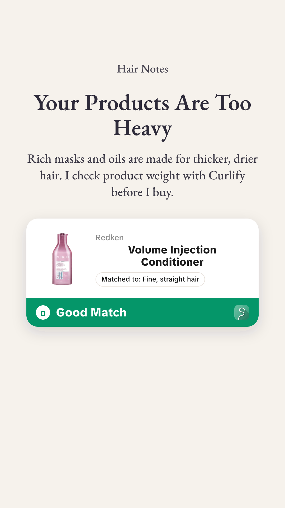

# Why your hair gets greasy so fast

**Hook:** Why Your Hair Gets Greasy So Fast

**Description**

Why fine and straight hair gets greasy fast: touching it, conditioner on the roots, an old pillowcase, and products that are too heavy. Check yours with Curlify. #haircare #hairtok #greasyhair #finehair #hairtips

**Pinned comment:** which one is you? 👀

