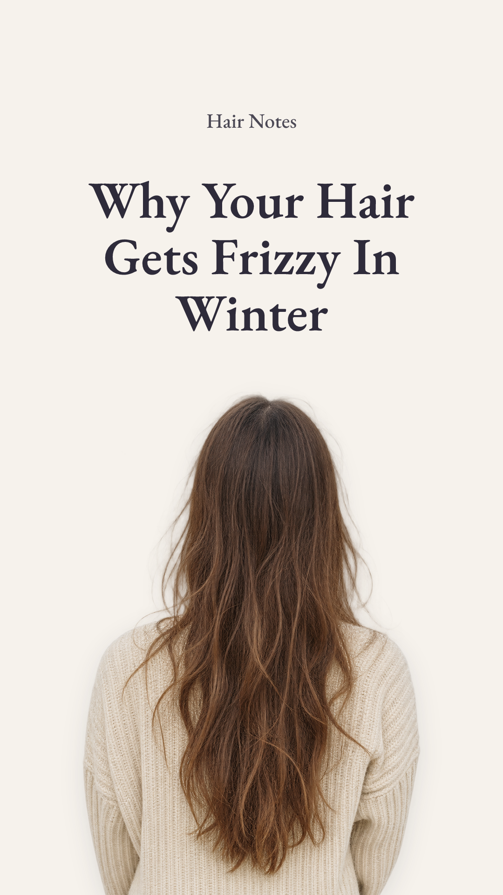
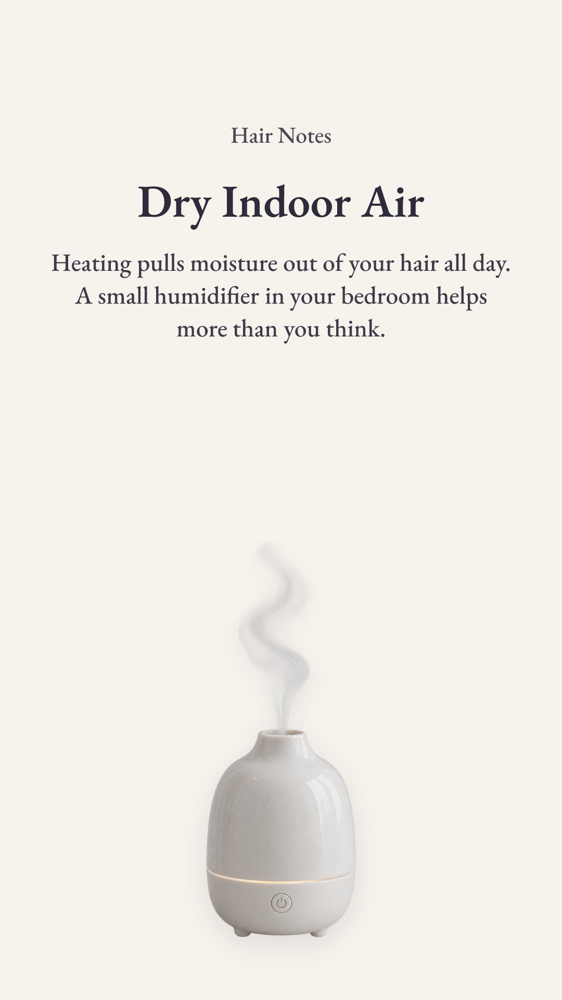
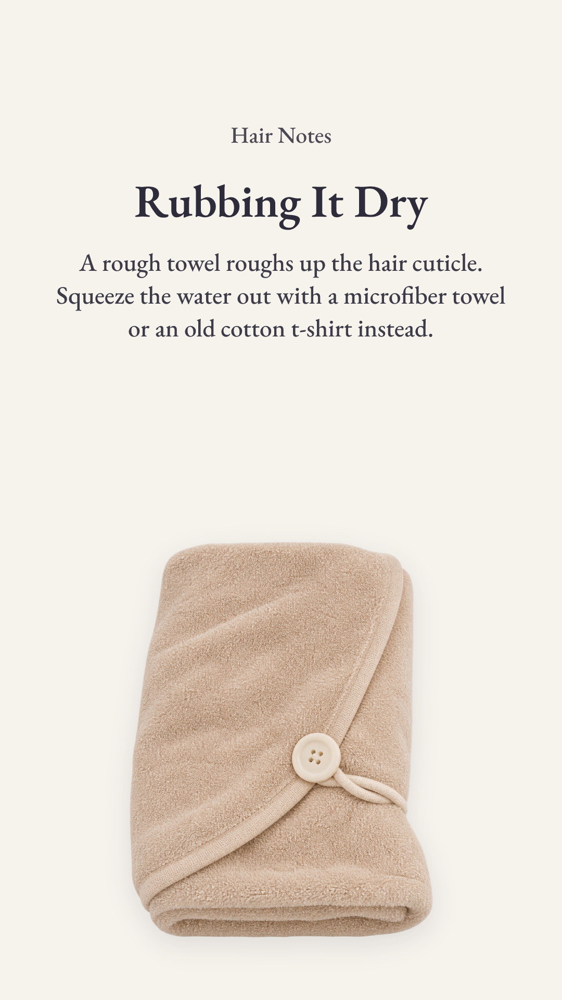
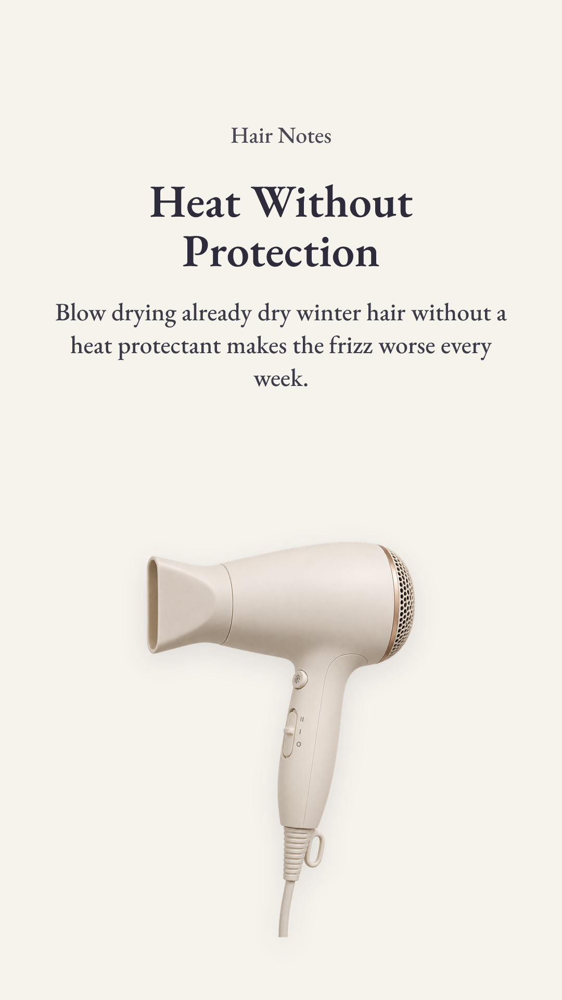
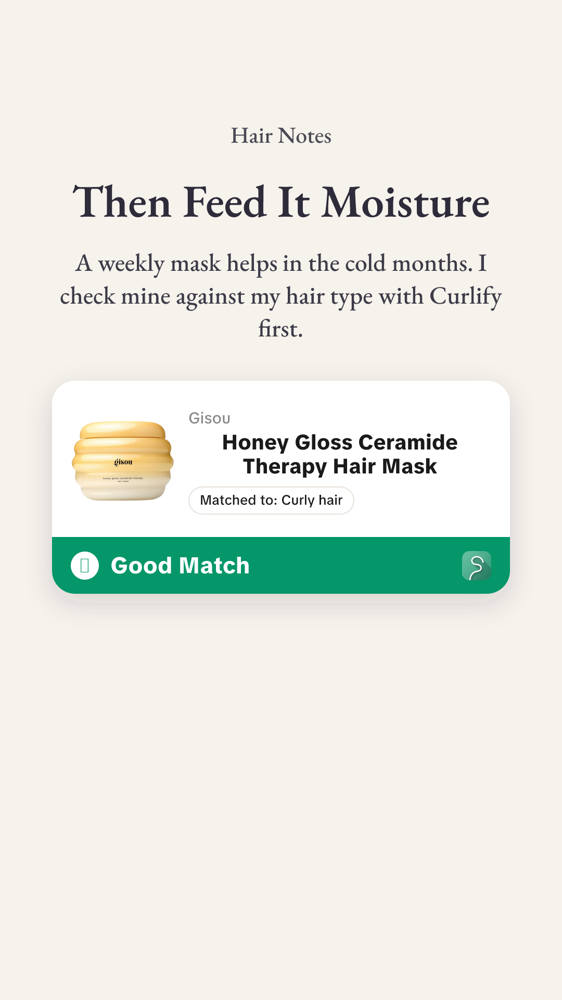

# Why your hair gets frizzy in winter

**Hook:** Why Your Hair Gets Frizzy In Winter

**Description**

Why hair gets frizzy in winter: dry indoor air, rubbing it dry with a towel, and heat without protection. Check what your hair needs with Curlify. #haircare #hairtok #frizzyhair #winterhair #hairtips

**Pinned comment:** which one were you doing? 👀

