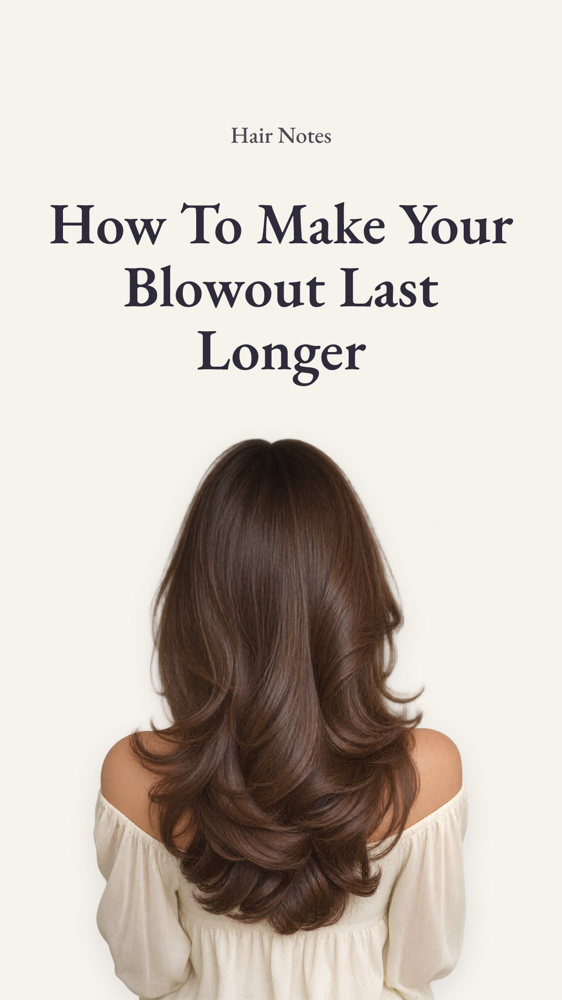
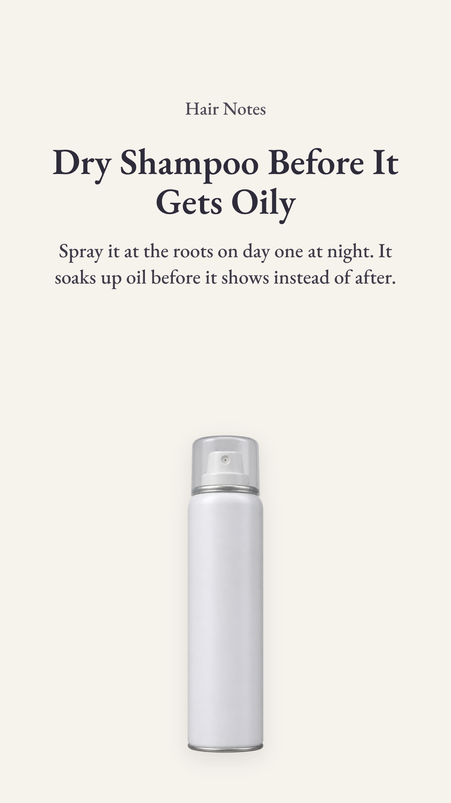
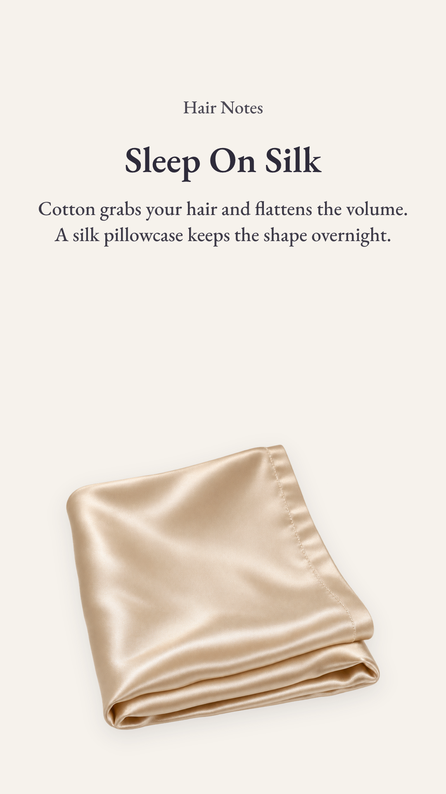
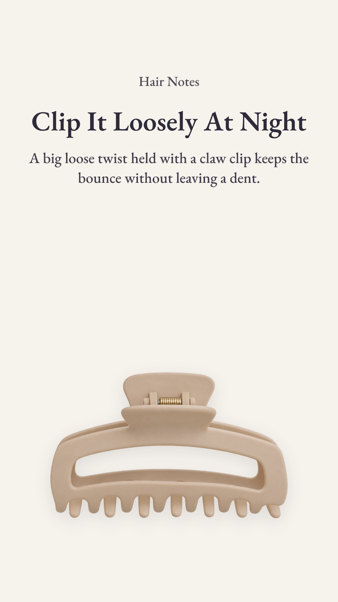
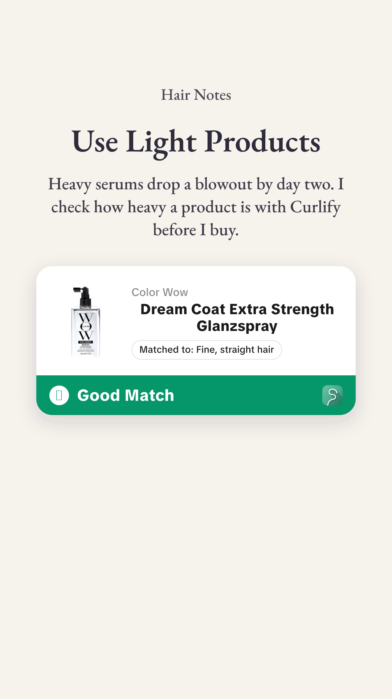

# How to make your blowout last longer

**Hook:** How To Make Your Blowout Last Longer

**Description**

How to make a blowout last for days: dry shampoo before it gets oily, a silk pillowcase and a loose clip at night. Check your styling products with Curlify. #haircare #hairtok #blowout #hairtips #finehair

**Pinned comment:** how many days does yours last? 👀

