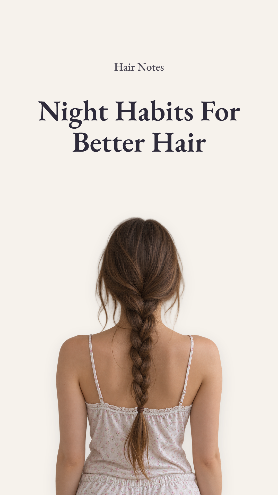
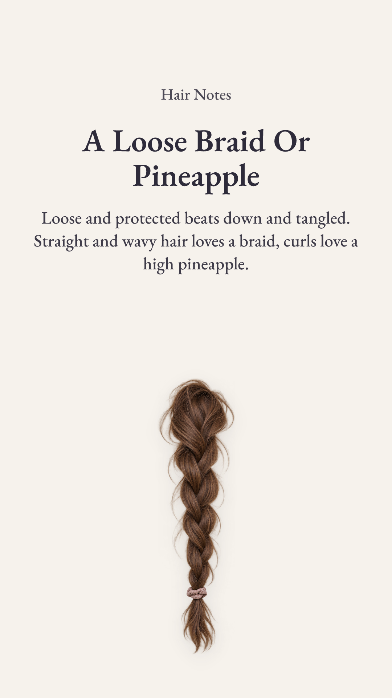
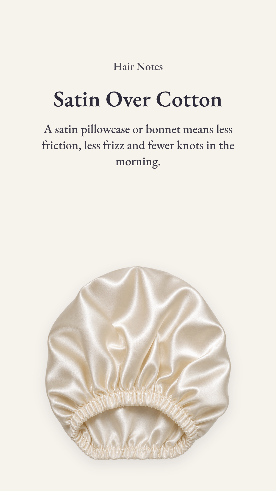
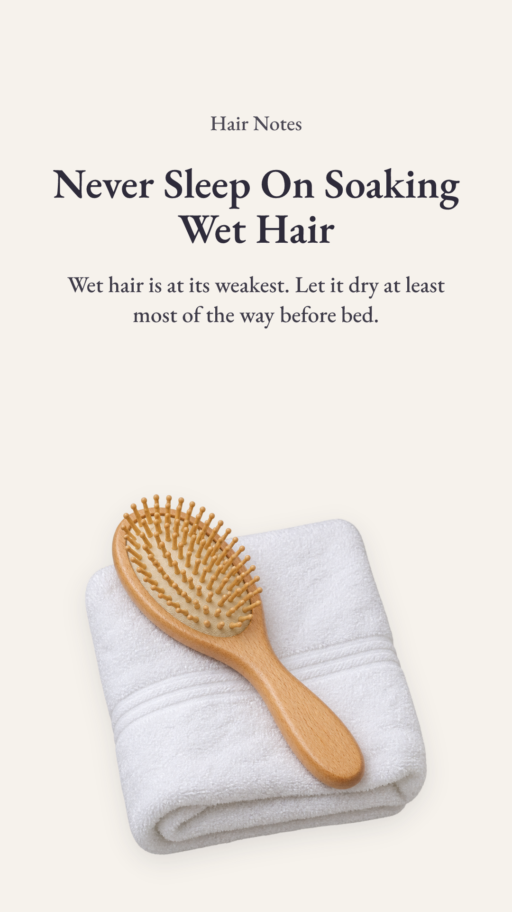
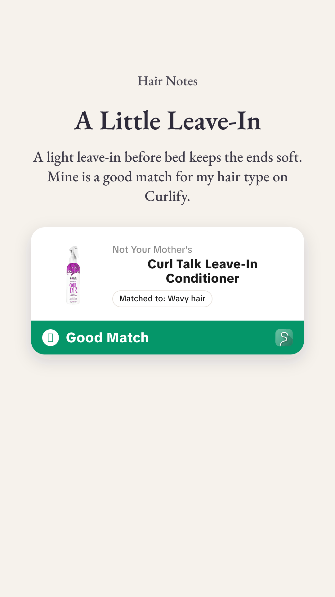

# Night habits for better hair

**Hook:** Night Habits For Better Hair

**Description**

Overnight hair habits for every hair type: protect it with a loose braid or pineapple, sleep on satin, and never go to bed with soaking wet hair. Check your leave-in with Curlify. #haircare #hairtok #nightroutine #hairtips #satinpillowcase

**Pinned comment:** what do you do with your hair at night? 🌙

