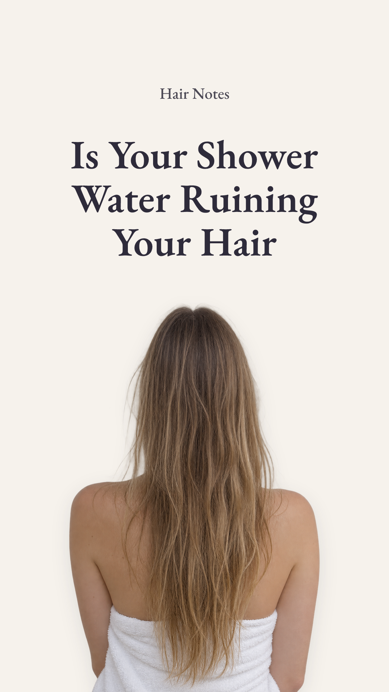
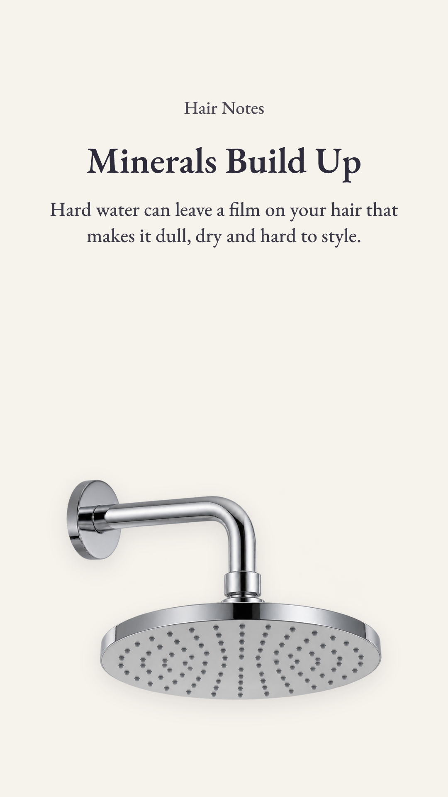
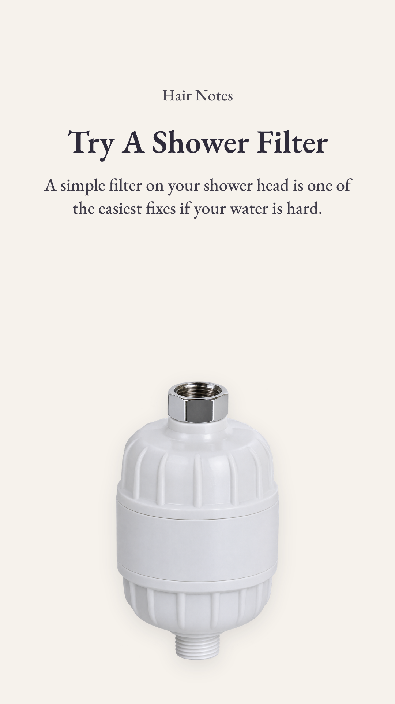
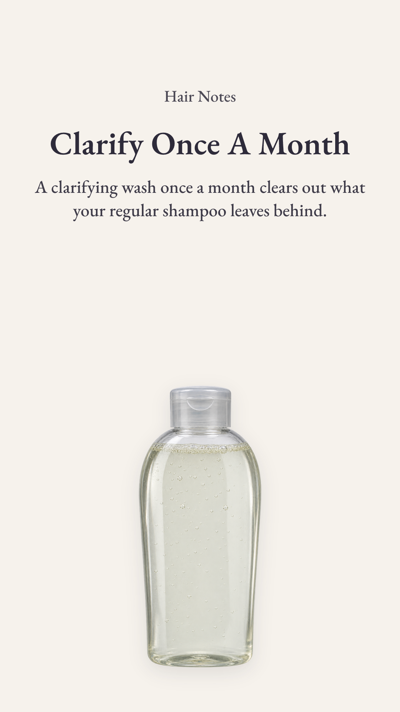
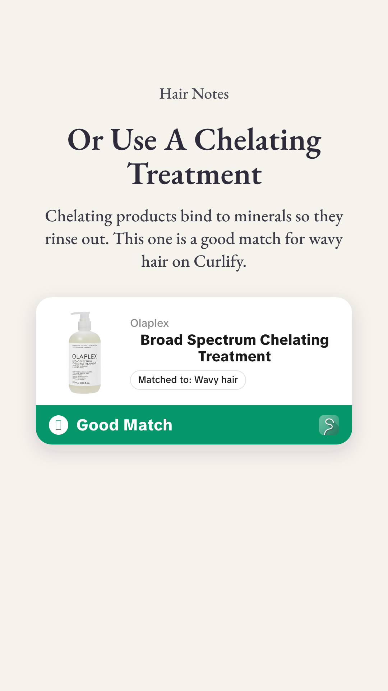

# Is your shower water ruining your hair

**Hook:** Is Your Shower Water Ruining Your Hair

**Description**

Hard water can leave mineral buildup that makes hair dull and hard to style. A shower filter, a monthly clarifying wash and a chelating treatment can help. Check your products with Curlify. #haircare #hairtok #hardwater #hairtips #dullhair

**Pinned comment:** do you have hard water where you live? 💧

