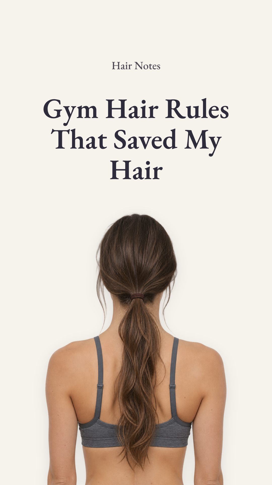
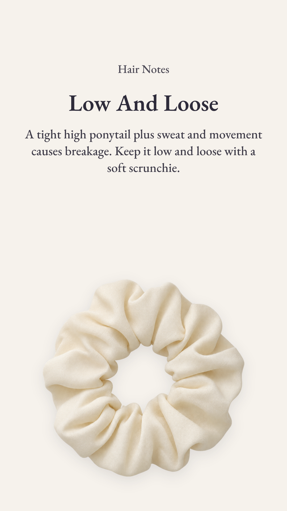
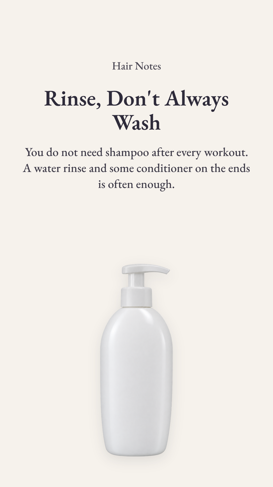
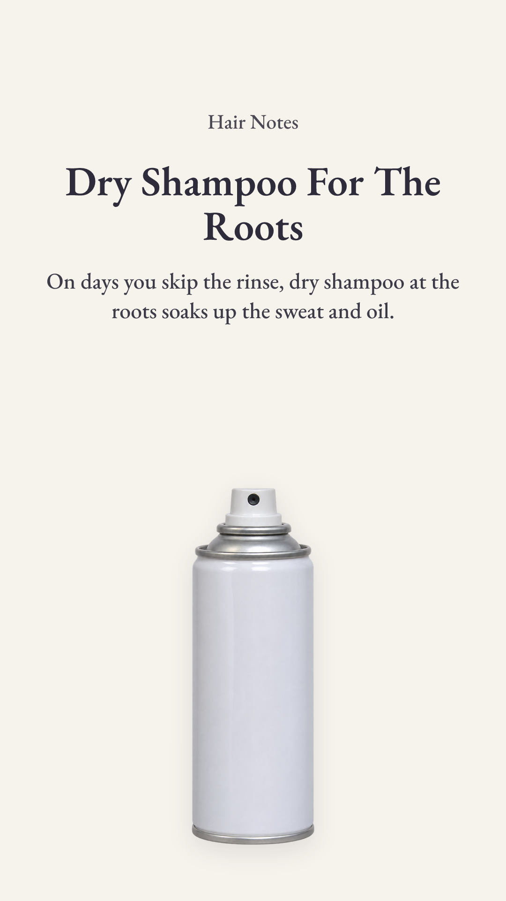
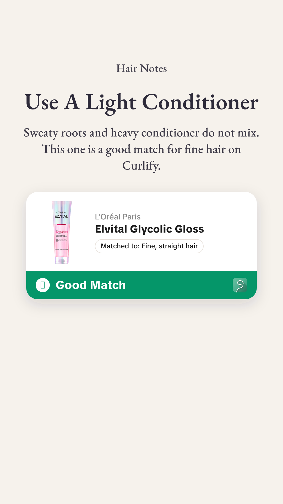

# Gym hair rules that saved my hair

**Hook:** Gym Hair Rules That Saved My Hair

**Description**

How to protect your hair at the gym: a low loose ponytail with a soft scrunchie, rinse instead of a full wash, and dry shampoo at the roots. Check your products with Curlify. #haircare #hairtok #gymhair #workouthair #hairtips

**Pinned comment:** do you wash your hair after every workout? 🏋️‍♀️

