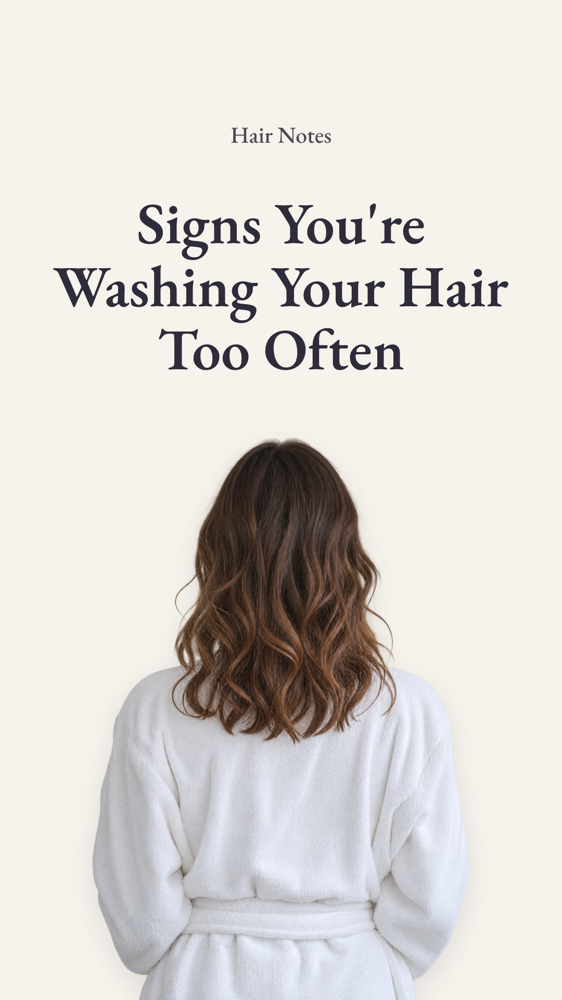
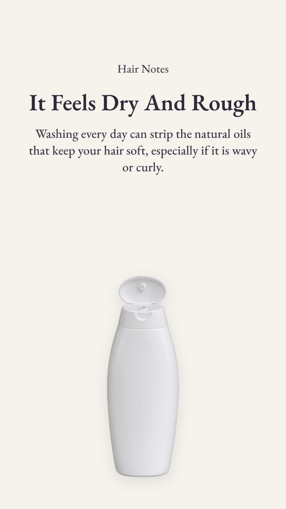
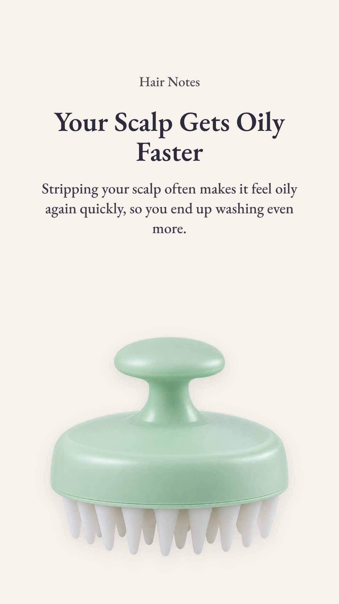
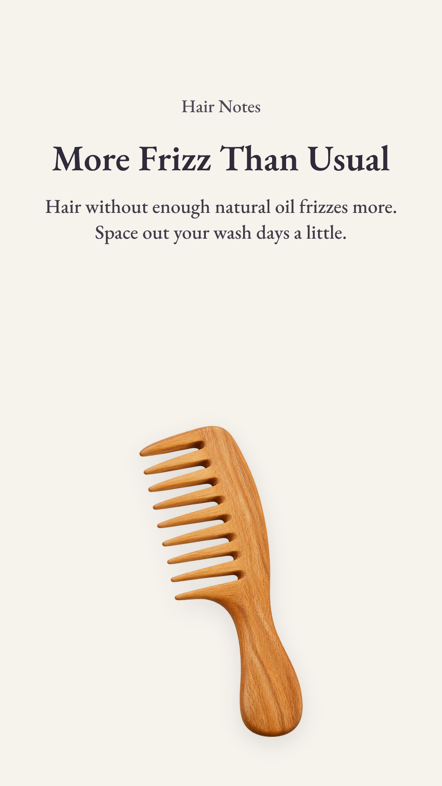
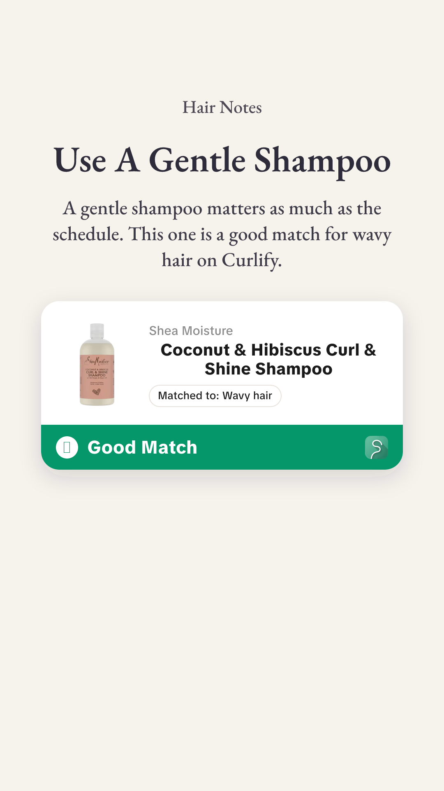

# Signs you're washing your hair too often

**Hook:** Signs You're Washing Your Hair Too Often

**Description**

Signs you might be washing your hair too often: it feels dry and rough, your scalp gets oily faster, and it frizzes more. Find a shampoo for your hair type with Curlify. #haircare #hairtok #washday #hairtips #dryhair

**Pinned comment:** how often do you wash yours? 🫧

