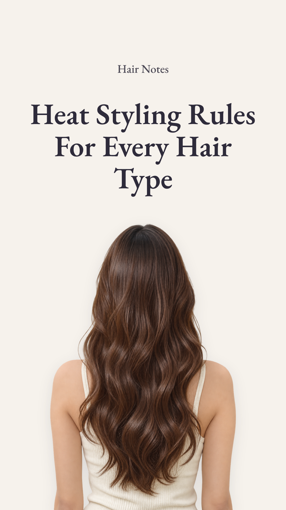
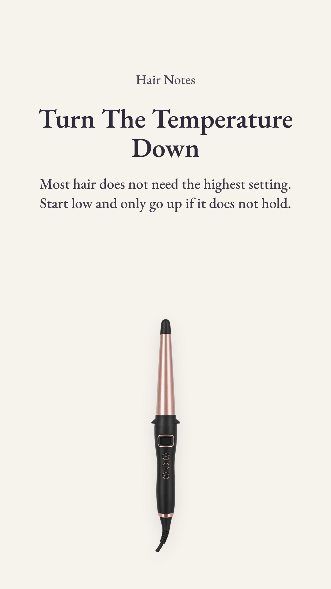
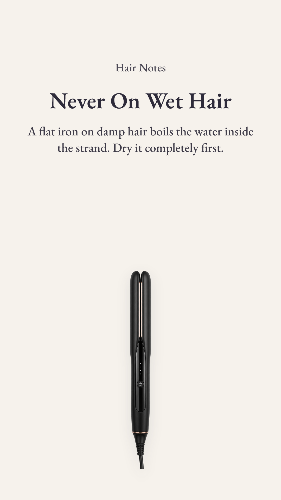
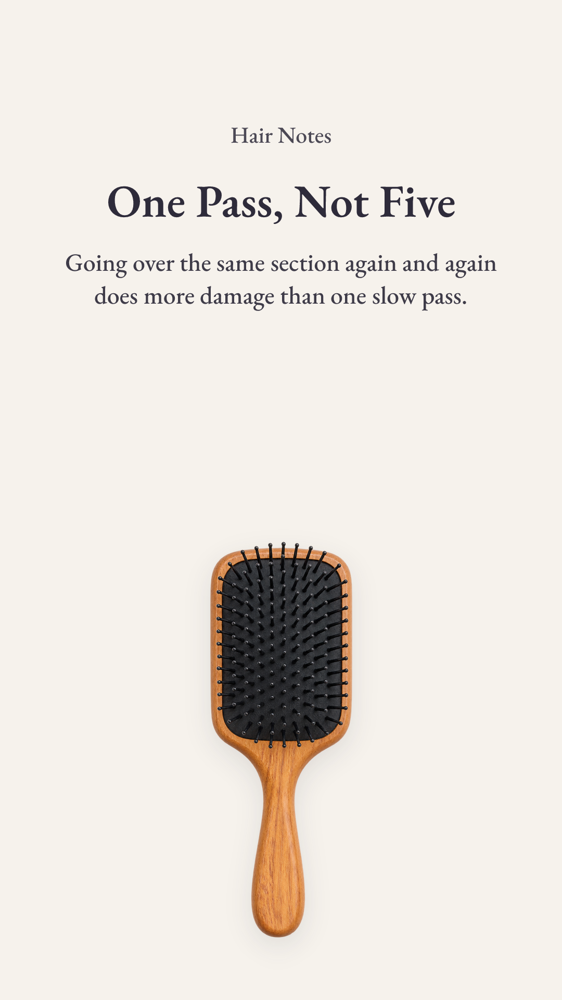
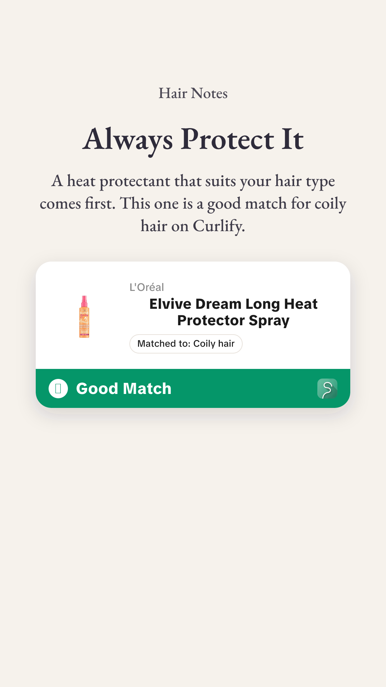

# Heat styling rules for every hair type

**Hook:** Heat Styling Rules For Every Hair Type

**Description**

Heat styling rules that protect your hair: lower temperatures, never on wet hair, and always a heat protectant. Check your heat protectant with Curlify. #haircare #hairtok #heatprotectant #hairtips #heatdamage

**Pinned comment:** what temperature do you use? 🔥

